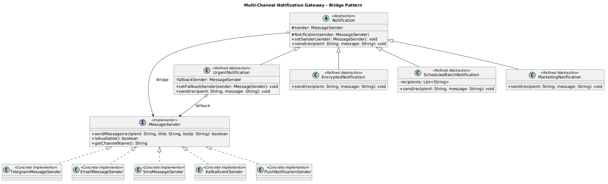

# Multi-Channel Notification Gateway

**Course:** Software Design Patterns  
**Assignment 3 Bridge Pattern**  
**Student:** Zhumabay Akmaral  
**Group:** SE-2517  
**Language:** Java 17  
**Build Tool:** Maven

## 1. Project Description

This project implements a Multi-Channel Notification Gateway using the Bridge Design Pattern.

The system separates notification types from message delivery providers, allowing both to evolve independently.

All message delivery providers are simulated. No external APIs are required.

## 2. Implementation

### Notification Types (Abstraction)

- UrgentNotification — adds an urgent prefix and supports fallback.
- EncryptedNotification — transforms messages using Base64.
- ScheduledBatchNotification — sends messages to multiple recipients and produces a summary.
- MarketingNotification — adds a marketing prefix.

### Message Senders (Implementation)

- TelegramMessageSender — supports formatted messages.
- EmailMessageSender — supports subject and signature.
- SmsMessageSender — enforces a 160-character message limit.
- KafkaEventSender — simulates publishing an event.
- PushNotificationSender — simulates push notifications.

## 3. UML Class Diagram

The diagram shows the Abstraction, Refined Abstractions, Implementor, Concrete Implementors, and Bridge relationship.

## 4. Mandatory Demo

The Main class demonstrates six scenarios:

1. UrgentNotification + Telegram
2. EncryptedNotification + Email
3. ScheduledBatchNotification + SMS
4. Runtime switching from Telegram to Email
5. Telegram unavailable with SMS fallback
6. MarketingNotification + PushNotificationSender

## 5. Running the Application

Requirements:
- Java 17 or higher
- Maven

Open the project in IntelliJ IDEA.

Run `Main.java` to execute all six scenarios.

To run the unit tests, open the Maven tool window and execute:

Lifecycle → test

The project contains 12 JUnit 5 tests covering delivery, availability, fallback, SMS limits, encryption, batch notifications, runtime switching, and independent extensions.

## 6. Bridge Pattern Questions

### 1. What are the two independent dimensions?

The two dimensions are notification types and message delivery providers.

Notification types define how messages are processed, while providers define how messages are delivered.

### 2. Where exactly is the Bridge?

The Bridge is the MessageSender reference inside the Notification abstract class:

`protected MessageSender sender;`

This allows notifications to communicate with different providers through a common interface.

### 3. Why is inheritance problematic here?

Without Bridge, separate classes would be needed for every notification-provider combination, such as UrgentTelegramNotification and UrgentEmailNotification.

With N notification types and M providers, this could require N × M classes, making the system difficult to maintain and extend.

### 4. What happens when a new provider is added?

A new class implementing MessageSender is created.

For example, PushNotificationSender was added without modifying existing notification classes.

### 5. What happens when a new Notification type is added?

A new class extending Notification is created.

For example, MarketingNotification was added without modifying existing message senders.

### 6. Why is this Bridge rather than Adapter?

Bridge separates two independent hierarchies by design, allowing them to evolve independently.

Adapter is used to make existing incompatible interfaces work together.

In this project, the separation between Notification and MessageSender is intentional, so Bridge is the appropriate pattern.
